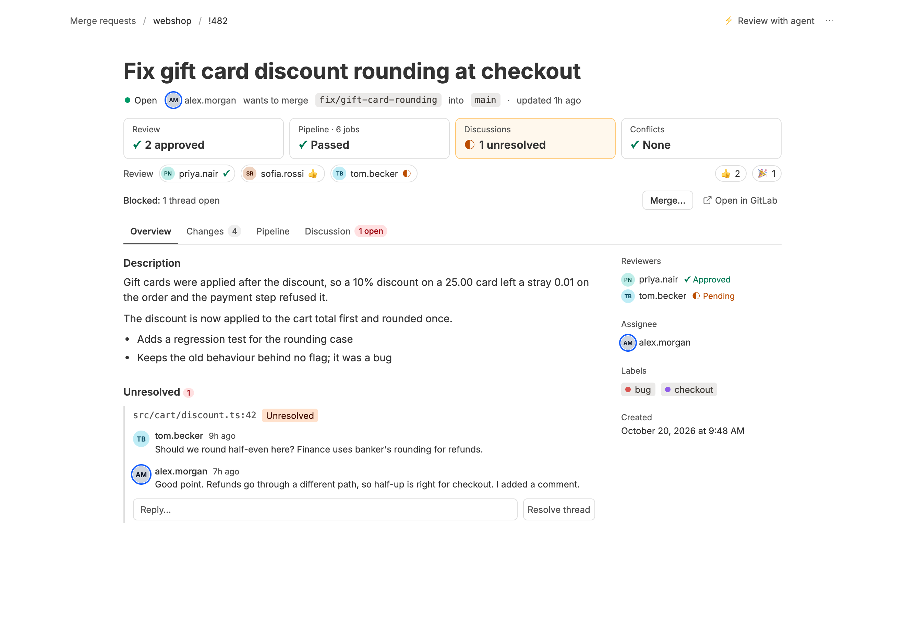
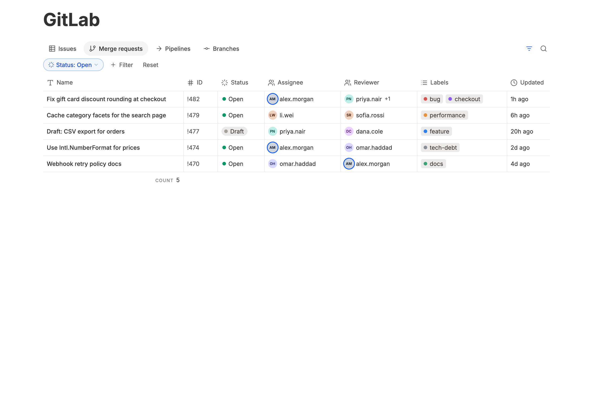
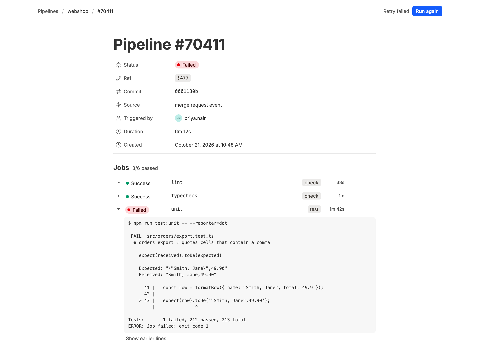
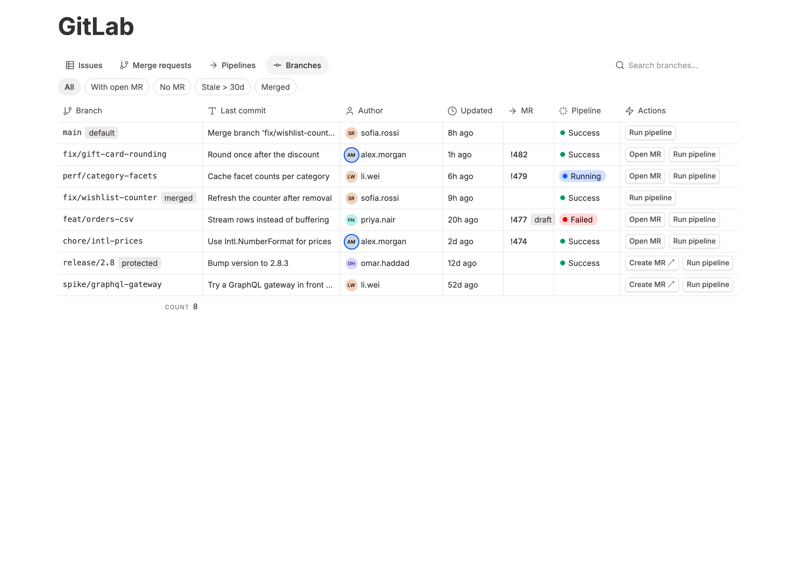

# GitLab Interface (Notion style)

GitLab issues and merge requests inside [BB](https://getbb.app), with one-click
agent dispatch. Self-managed instances are first-class: every host `glab` is
logged into is a host this plugin can reach.

A Notion-style panel for GitLab, with a `bb gitlab-ui` CLI for agents and terminals.




| Merge requests | Failed pipeline | Branches |
|---|---|---|
|  |  |  |

Screenshots use invented demo data.

## Features

- **A Notion-style panel.** Issues, merge requests, pipelines, and branches are
  four views of one database: view tabs, filter pills, inline search,
  hairline-ruled tables with hover-only row actions. Each item opens as a page.
  Filter pills and search edit the same query string, so the old
  `is:open assignee:@me` grammar still works (now with `reviewer:`).
- **Merge-request page built around "can this merge?"** A readiness strip
  (pipeline, approvals, discussions, merge status), the failing job's log tail
  on the page, tabs for Changes, Pipeline, and Discussion, and a rail where
  reviewers (with Approved/Pending), assignees, and labels are editable.
- **Cherry-pick tracking.** A Commits tab lists the merge request's commits
  and whether each is already on a branch you choose (for example `stage-1`):
  by SHA, by a `cherry-pick -x` line, or by an identical diff. Same title with
  a different diff is flagged for a manual look. Select the missing ones and an
  agent cherry-picks them with `-x` onto a new branch and opens a merge request.
- **Views and wide tables.** "Review requests" and "Mine" views on merge
  requests, a pinned Name column, an Author column, and column widths you can
  drag (double-click a column edge to reset).
- **Merge from the panel.** A Merge button on every open merge request, with a
  confirmation that shows the exact branches and commit, options for squash,
  deleting the branch, and "merge when the pipeline succeeds". Anything not
  green (failed pipeline, no review, open threads) is listed and needs an
  explicit "Merge anyway". The merge is pinned to the commit you were looking
  at, so a branch that moved in the meantime is refused, and GitLab still
  enforces its own required pipelines and approvals.
- **Threads you can answer.** The Discussion tab shows every thread and comment
  with a Reply box that posts into the same GitLab thread, plus Resolve / Reopen.
- **Review at a glance.** "Reviewed or not" sits under the title: formal
  approvals and 👍 / ✅ reactions count together (a 👎 reads as changes
  requested), with the reactions shown beside it.
- **The panel remembers.** Switching to a thread and back returns you to the
  same page, tab, filters, and scroll position.
- **Pipelines in the panel.** The project's pipelines, a pipeline page with its
  jobs and logs, Retry failed, Retry/Play/Cancel per job, Run pipeline. Live
  pipelines refresh on their own.
- **Branches.** Newest branches first with the default branch on top, the last
  commit and author, the open merge request, the latest pipeline, and
  Create MR / Run pipeline actions.
- **Reviewers and search everywhere.** A Reviewer column and filter on merge
  requests, and a search box in every filter and picker menu, fed by all
  project members and labels (paged), not just those on the loaded rows.
- **Color that means something.** Each person gets a stable avatar color and
  your own avatar has a ring; labels are quiet tags with a dot in GitLab's own
  label color; expected states (open, passed) are quiet, so red and amber mark
  what needs a person.
- **A fuller CLI**, usable by you and by agents: `show`, `comment`, `pipeline`
  (jobs plus the tail of each failed job's log), `retry`, `run`, and filters on
  `issues` / `mrs` (`--state`, `--mine`, `--author`, `--assignee`,
  `--reviewer`, `--label`, `--draft`, `--limit`, `--json`).
- **Fixes.** Quick assignee or label toggles could send an empty list and
  clear every value on GitLab; they no longer do.

Not here yet: ahead/behind counts and a dedicated page per branch.

## Settings

Open BB → Settings → Plugins → GitLab Interface (Notion style).

| Setting | Default | What it does |
|---|---|---|
| Cherry-pick tracking branch | empty (off) | Branch checked on every merge request, e.g. `stage-1`. Anyone can still pick another branch on the Commits tab. |
| Assignees count as reviewers | off | For teams that request reviews through the assignee field; affects the "Review requests" view. |
| Count 👍 as approval | off | A thumbs-up from someone other than the author counts as an approval in the review summary. |
| Allow merging from the panel | on | Shows the Merge button. GitLab still enforces its own merge rules. |
| New-thread dashboard: layout | `counters` | `counters` (tiles over one list), `sections` (collapsible toggles) or `off`. |
| New-thread dashboard: groups and order | `action,ready,review,waiting` | Any of `action`, `ready`, `review`, `waiting`, `drafts`, `issues`, in display order. |
| New-thread dashboard: rows per group | `8` | 3, 5, 8, 12 or 20. |
| New-thread dashboard: hide empty groups | off | Drop groups with nothing in them. |
| New-thread page: composer at the bottom | off | Pins the message box to the bottom of the New thread page and centres the dashboard above it. |
| New-thread dashboard: groups collapsed by default | `waiting` | Sections layout only. |
| Extra projects / Default GitLab host / Default BB project | | See "Which projects are tracked". |

## Install

The plugin id is `gitlab-interface-notion-style` and its command is `bb gitlab-ui`.

```sh
bb plugin install git:https://github.com/KosachMax/bb-plugin-gitlab-interface-notion-style.git
```

or from a local checkout, which is what you want while hacking on it:

```sh
git clone https://github.com/KosachMax/bb-plugin-gitlab-interface-notion-style.git
cd bb-plugin-gitlab-interface-notion-style && npm install --include=dev && bb plugin build
bb plugin install "$PWD"
```

## License

MIT. The code started from Marius Nouchet's MIT-licensed GitLab plugin for BB, so the original copyright notice stays in `LICENSE`.

## What it does

- **Sidebar panel** (GitLab tanuki, full width), shaped like a Notion database:
  Issues and Merge requests view tabs over one table across every tracked
  project, with filter pills (Status, Draft, Assignee, Author, Label, Project —
  `Me` and `No assignee` / `No label` included) and an inline search. Pills and
  search edit one query string in the same grammar as before — `is:open`,
  `assignee:@me`, `label:"needs triage"`, `no:label` — so typing a qualifier
  into search turns it into a pill. The query persists in localStorage.
- **Issue page**: a Notion page — title, a property block whose value cells
  edit state, assignees, and labels in place, page comments, the markdown
  description, plus "Send agent". Deep-linkable through the URL hash:
  `#/issues/<host>/<namespace/path>/<iid>`.
- **Merge-request page**: source → target branch, mergeability, pipeline,
  approvals, reviewers, and comments as properties, then Pipeline, Discussions,
  and Changes as toggle sections with per-file diffs rendered by the same syntax-highlighting engine as the rest of
  BB, following the host's code theme. Deep-linkable as
  `#/merge_requests/<host>/<namespace/path>/<iid>`.
- **Send agent / Review with agent**: spawns a BB worker thread on the issue (or
  a review thread on the merge request) in the matching BB project. The item
  then shows a ⚡ pill linking to the thread.
- **Homepage section**: recent open issues with the same Send agent buttons.
- **Mentions**: `#` completes GitLab issues, `!` completes merge requests (`@`
  does both); the selected item's title, state, and description are attached as
  agent context at send time.
- **`bb gitlab-ui` CLI**, also discoverable by agents through the plugin-commands
  skill, alongside the bundled `gitlab` skill that teaches `glab` conventions:
  - `projects`, `sync`
  - `issues` / `mrs [project]` with `--state open|closed|merged|all`, `--mine`,
    `--author`, `--assignee` (`@me` works), `--label` (repeatable), `--draft`,
    `--limit`, `--json`
  - `show <item>`: live issue/MR detail with comments; MRs add branches, merge
    status, approvals, and pipeline
  - `comment <item> <text…>`
  - `pipeline [target]`: jobs plus the tail of each failed job's log
    (`--ref`, `--pipeline`, `--logs <n>`, `--json`)
  - `retry [target]`: re-run failed and canceled jobs, or one with `--job`
  - `run [target]`: start a fresh pipeline for an MR or on `--ref`

  An item is `host/group/app#7`, `host/group/app!12` (single-quote refs in a shell), or its
  web URL. A target may also be a project or a pipeline/job URL; omitted, it is
  the GitLab project of the BB project the command runs in.

## Auth and any GitLab domain

Uses the GitLab CLI, so the plugin reaches whatever instances `glab` reaches —
`gitlab.com`, a self-managed instance on any domain, or several at once. Every
host that appears as `Logged in to <host> as <user>` in `glab auth status` is
usable; if no host is authenticated the plugin reports needs-configuration. No
tokens are stored by the plugin.

```sh
glab auth login --hostname gitlab.example.dev
bb plugin reload gitlab
```

A host's own glab config describes how it is reached, and the plugin reads that
config instead of guessing, so these all work:

| Hosting | glab config on that host | What the plugin does |
| --- | --- | --- |
| Plain domain, any TLD | — | uses the hostname as-is |
| Served under a path, `https://example.com/gitlab/` | `subfolder: gitlab` | drops the subfolder from project paths |
| API on a non-default port | `api_host: example.com:8443` | maps the port-bearing remote back to the host |
| Git over SSH on another name | `ssh_host: ssh.example.com` | maps that remote to the same instance |
| Plain HTTP, private CA, mTLS, proxy | `api_protocol`, `ca_cert`, `client_cert`, `proxy` | nothing needed — glab applies them |
| Internationalized domain | — | normalized to punycode, matched case-insensitively |

Ports and schemes never appear in a project ref: `glab --hostname` takes a bare
hostname, and the ref keeps exactly the name glab knows. IPv6 literal hosts are
the one gap, because glab rejects them.

## Which projects are tracked

A project is addressed by its **host-qualified ref**:
`gitlab.example.dev/group/subgroup/app`. The host is the first segment; the rest
is the namespace path, which may have any number of segments.

- Every BB project whose git remote points at an authenticated GitLab host —
  including remotes that use that host's `ssh_host`, `api_host`, or subfolder
  form. That mapping is also how "Send agent" picks the BB project to spawn in.
  The remote comes from BB's own project record, so a checkout on an enrolled
  remote host resolves exactly like a local one. A remote on a GitLab host glab
  is not logged into is reported in `bb plugin logs gitlab`.
- Plus the `extraProjects` setting: a comma-separated list of refs, normalized
  for you — a scheme, mixed case, a port, a subfolder, or a trailing slash are
  all accepted, and a bare `group/app` uses `defaultHost`.
- `defaultProject`: where threads spawn for GitLab projects with no BB project.

```sh
bb plugin config gitlab set extraProjects "https://Code.Example.dev:8443/gitlab/group/app, other/app"
bb plugin config gitlab set defaultHost gitlab.example.dev
bb plugin reload gitlab
```

A background service refreshes the issue/MR cache every 5 minutes; the panel's
Refresh button (or `bb gitlab-ui sync`) forces it. The cache holds open items plus
a page of recently closed and merged ones, and the panel filters that cache in
the browser, so `is:closed` or `is:merged` costs nothing. Detail views,
mutations, and mention resolution always go live through `glab api`.

## Development

```sh
npm install --include=dev   # once
npm run typecheck
npm test
bb plugin build             # dist/server.js + dist/app.js + dist/app.css
bb plugin reload gitlab
```

`bb plugin dev` watches and reloads on every save. Plugin logs:
`bb plugin logs gitlab -f`.
